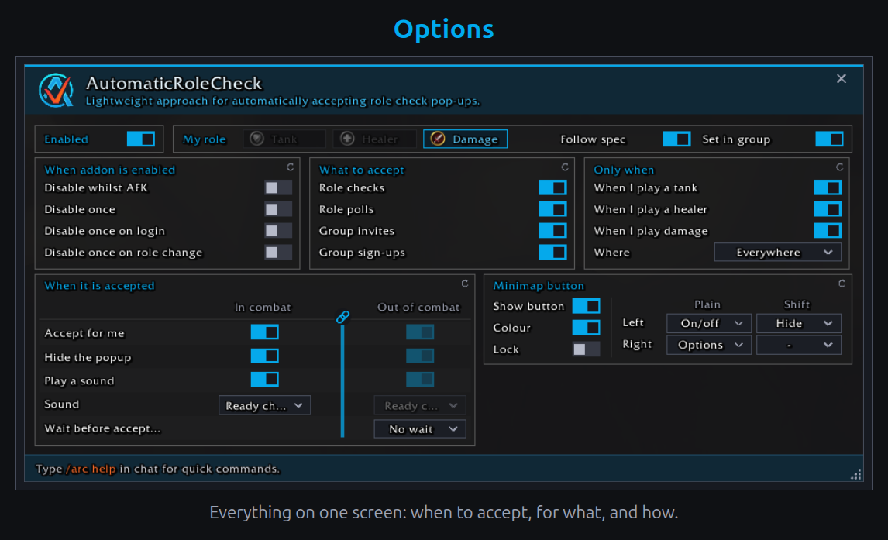
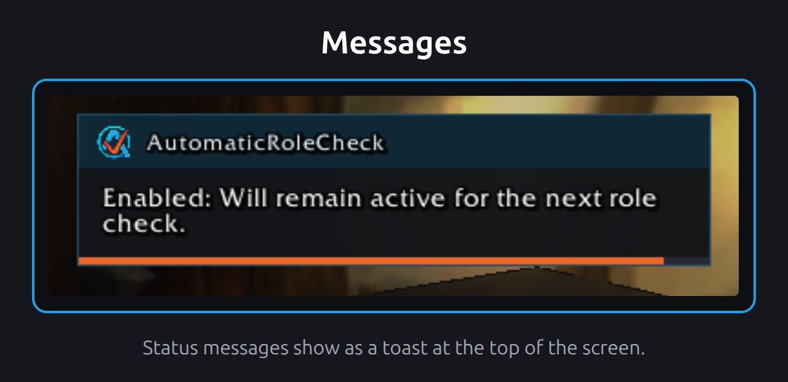
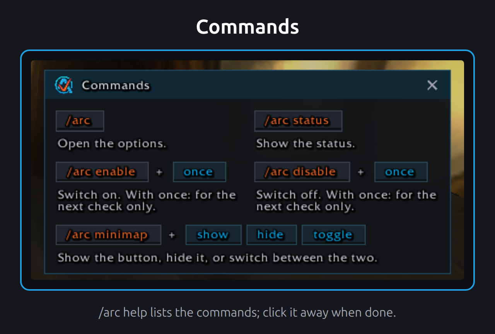

# AutomaticRoleCheck

Lightweight approach for automatically accepting role check pop-ups.

<!-- release:start -->
  
<!-- release:end -->

## Usage

Type `/arc` to open the options window. You can also open it from the game's settings: **AutomaticRoleCheck** > **Open AutomaticRoleCheck**.
Drag the grip in the bottom right corner to change the width and height of the window; right-click the grip to go back to the default size.
Every option shows a tooltip when you hover it. Most boxes have a `Reset` link that puts the settings of that box back to their defaults; click it twice to confirm.

### Enabled and My role

- `Enabled`: switches the addon on or off.
- `My role`: the `Tank`, `Healer` and `Damage` roles a role check gives you when you queue. Click a role to switch it on or off (not in combat).
- `Follow spec`: your roles follow your specialization.
- `Set in group`: also sets your role in your group, when you change it here or join a group (not in combat).

### When addon is enabled

- `Disable whilst AFK`: do not accept while you are AFK.
- `Disable once`: skip the next role check.
- `Disable once on login`: skip the first role check after you log in.
- `Disable once on role change`: skip the next role check after you change your role.

### What to accept and Only when

- `What to accept`: `Role checks`, `Role polls`, `Group invites` and `Group sign-ups`.
- `Only when`: `When I play a tank`, `When I play a healer`, `When I play damage`, and `Where`: `Everywhere`, `Group or instance` or `Instance only`.

### When it is accepted

The table has an `In combat` and an `Out of combat` column. The game doesn't let addons accept in combat, so in combat the popup waits and is accepted right after combat ends.

- `Accept for me`: accept the popup for you. Off: you click the popup yourself.
- `Hide the popup`: hide the game's popup while it waits or is accepted.
- `Play a sound` and `Sound`: play `Raid warning`, `Ready check`, `Quest complete`, `Auction bell` or `Whisper`.
- `Wait before accepting` (out of combat only): `No wait`, or 1, 2, 3 or 5 seconds to step in yourself.
- `Linked`: the `Out of combat` column follows the `In combat` column. `Separate`: each column is set by itself.

By default both columns accept for you, hide the popup and play the `Ready check` sound.

While the addon is on, the game's own ready-check sound is muted (also for normal ready checks), so only the sound you chose plays.

### When addon is disabled

- `/arc disable`: turn the addon off.
- `Enable once`: accept the next role check. `/arc enable once` does the same.

### Commands

Messages show as toasts at the top of the screen; click a toast to close it.

- `/arc`: open the options window.
- `/arc help`: show the commands.
- `/arc status`: show the status for the next role check.
- `/arc enable [once]`: switch on, or with `once` for the next check only.
- `/arc disable [once]`: switch off, or with `once` for the next check only.
- `/arc minimap [show|hide|toggle]`: show the minimap button, hide it, or switch between the two.

### Skipping next role check

For in-the-moment use, this is the fastest way to skip a single role check:
- Hold `Shift` while the role check appears, and only that upcoming check will be skipped.

If you prefer planning ahead, you can use `/arc disable once` (or `Disable once`) before the next role check appears.

### Minimap button

The check mark on the button is green when the addon is on, red when it is off, and amber while something waits for combat to end.
By default:

- `Left-click`: switch on or off.
- `Shift + Left-click`: hide the button.
- `Right-click`: open the options.

In the `Minimap button` box you choose what `Left-click`, `Right-click`, `Shift + Left-click` and `Shift + Right-click` do (`Switch on or off`, `Open options`, `Skip next check`, `Hide the button` or `Nothing`), and switch `Show button`, `Colour` (the status colour of the check mark) and `Lock` (no dragging around the minimap). The tooltip of the button lists your clicks.

## Screenshots

## Development

Please see [CONTRIBUTING](CONTRIBUTING.md) for development checks and contribution guidance.

## Feedback

Please remember that I'm always working to improve the addon, so I'm interested in hearing directly from you about anything you want to share or ask. You can report this using the issues on GitHub.
When reporting bugs or unexpected behavior, include your addon version and an overview of your current options.

## Changelog

Please see the [CHANGELOG](CHANGELOG.md) for more information about recent changes.

## License

This project is open-sourced software licensed under the [MIT license](https://opensource.org/licenses/MIT).

## Support me

If you find my work valuable or just want to show your appreciation, you can buy me a coffee!

