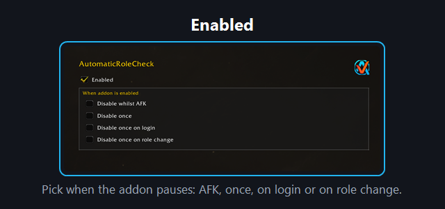
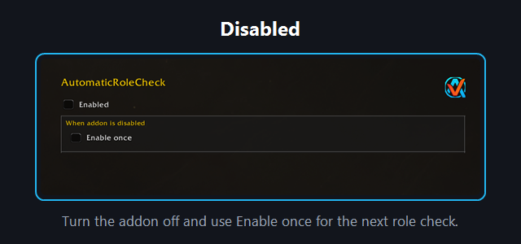
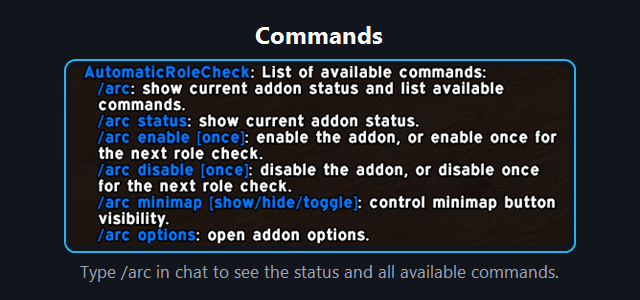

# AutomaticRoleCheck

Lightweight approach for automatically accepting role check pop-ups.

## Usage

### Enabled

You can configure these in `/arc options` while the addon is enabled:

- `Disable whilst AFK`: do not auto-accept while marked AFK.
- `Disable once`: skip the next role check.
- `Disable once on login`: skip the first role check after every login.
- `Disable once on role change`: skip the first role check after changing specialization role.

### Disabled

- `/arc disable`: turn the addon off.
- `Enable once`: accept the next role check. `/arc enable once` does the same.

### Commands

- `/arc`: show current addon version/status and list available commands.
- `/arc status`: show current addon version and status.
- `/arc enable [once]`: enable the addon, or enable once for the next role check.
- `/arc disable [once]`: disable the addon, or disable once for the next role check.
- `/arc minimap [show/hide/toggle]`: control minimap button visibility.
- `/arc options`: open addon options.

### Skipping next role check

For in-the-moment use, this is the fastest way to skip a single role check:
- Hold `Shift` while the role check appears, and only that upcoming check will be skipped.

If you prefer planning ahead, you can use `/arc disable once` before the next role check appears.

### Minimap button

- `Left-click`: enable/disable.
- `Shift + Left-click`: hide minimap button.
- `Right-click`: open options.

## Screenshots

## Development

Please see [CONTRIBUTING](CONTRIBUTING.md) for development checks and contribution guidance.

## Feedback

Please remember that I'm always working to improve the addon, so I'm interested in hearing directly from you about anything you want to share or ask. You can report this using the issues on GitHub.
When reporting bugs or unexpected behavior, include your addon version and an overview of your current options.

## Changelog

Please see the [CHANGELOG](CHANGELOG.md) for more information about recent changes.

## License

This project is open-sourced software licensed under the [MIT license](https://opensource.org/licenses/MIT).

## Support me

If you find my work valuable or just want to show your appreciation, you can buy me a coffee!

